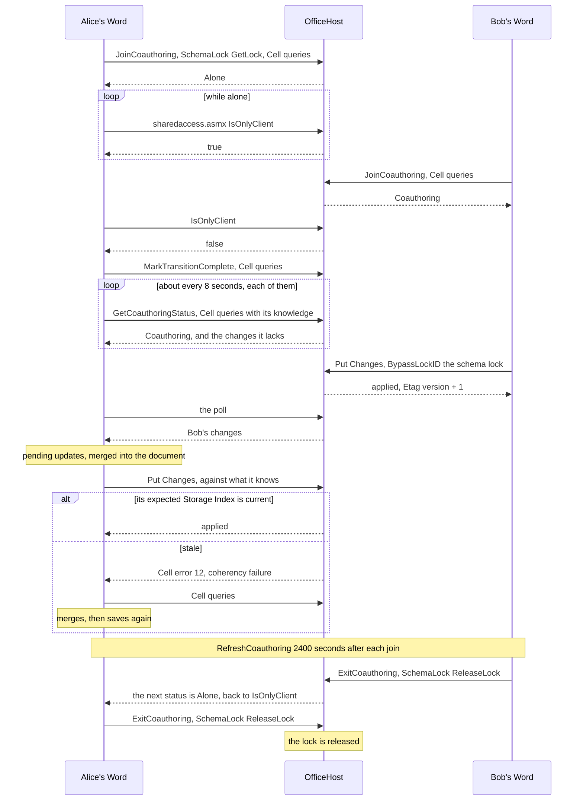
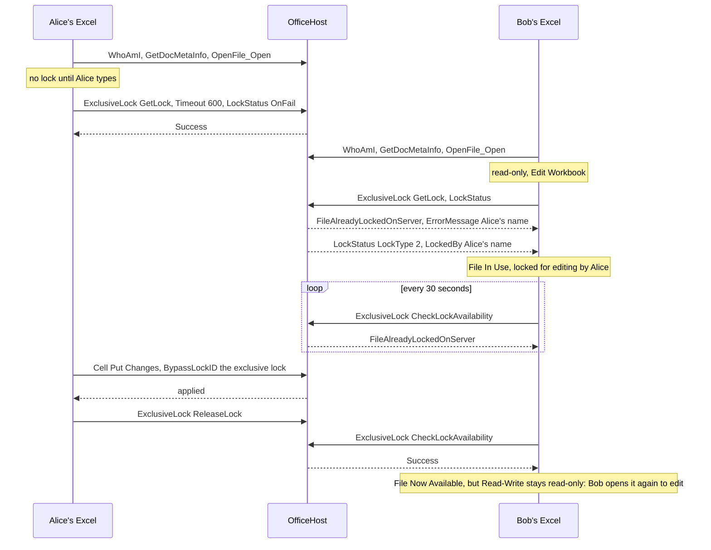

# FSSHTTP: several editors, locks and coherency

How desktop Office shares a file through [MS-FSSHTTP]: the coauthoring session and its schema lock (Word and PowerPoint), the coherency of a save, and the exclusive lock (Excel). The evidence is as in [fsshttp-notes.md](fsshttp-notes.md), which has the rest of where Office differs from the specs. For WOPI clients, which coauthor on their own servers, see [wopi-concurrency.md](wopi-concurrency.md). The manual tests are steps 8 to 28 of [fsshttp-checklist.md](fsshttp-checklist.md): a change outside Word, a restart, an idle hour, WOPI and desktop Office, two users coauthoring, and Excel.

## Coauthoring

Word and PowerPoint coauthor: every editor joins one session and shares its schema lock, and each merges the others' changes. PowerPoint's open is in fsshttp-notes.md ("PowerPoint coauthors as Word does").

### Coauthoring is a poll, not the refresh the spec describes

- **Spec:** [MS-FSSHTTP] 3.1.4.3.3 (Refresh Coauthoring Session) keeps a client in the session before its `Timeout`, and 3.1.4.3.7 (Get Coauthoring Session) reports who is in it.
- **Word, two users on SharePoint Server:**
  - **The poll:** every 8 seconds, `Scenario: PollingSubscriptionNotConnected_TransitionToCoauthInHostMode`, three Cell queries plus Coauth `GetCoauthoringStatus`, 159 times in 21 minutes. There was no `RefreshCoauthoring`, EditorsTable refresh or SchemaLock refresh in the 27 minutes after the open (`Timeout="2580"`): Word refreshes 40 minutes after the join (see "Word refreshes its lock 40 minutes after the join", below).
  - **When the second user arrived:** Word sent `MarkTransitionComplete` with the Cell queries (`Scenario: GetChangesFile_MarkCoauthTransitionCompleteAndDownload`).
  - **Before saving:** Word uploaded the metadata partition alone (`Scenario: Coauthoring_RequestUploadOnSecondaryMetadataPartition`).
- **Alone:** Word polls `sharedaccess.asmx` `IsOnlyClient` instead ([MS-SHDACCWS]).

### A remote change is pulled by the poll, merged at the next save

- **Word:** the poll's Cell queries carry Word's knowledge. After the other user's save, one answer brought their changes (and Etag version + 1), and Word's later queries changed with its knowledge. Word showed the changes as pending updates, and merged them into the document at its next save. That save's PutChanges did not fail coherency: Word merges before it uploads.

### Word refreshes its lock 40 minutes after the join

- **Spec:** [MS-FSSHTTP] 3.1.4.3.3 has a client refresh its coauthoring session before its `Timeout`, without saying when.
- **Word, alone, editing and then idle for 65 minutes** (step 10 of [fsshttp-checklist.md](fsshttp-checklist.md)):
  - **The polls:** `IsOnlyClient` of `sharedaccess.asmx` every 30 seconds (`Scenario: PollingSubscriptionNotConnected_AmIAlone`), 140 in the hour, after a burst every 8 seconds once the document is open. The burst was 1 poll against OfficeHost and 4 (32 seconds) against SharePoint Server (the lab of docs/sharepoint-lab.md), whose `IsOnlyClient` answers are the same: the rate is Word's, not the server's. During SharePoint's burst Word was still calling its REST API (`GetSharingInformation`, a 404 against OfficeHost). At 21, 49 and 58 minutes, a pair of Cell queries of the content and the metadata (`Scenario: GetChangesFile_PowerAndPresenceStateChange`).
  - **The refresh:** 2400 seconds after the join, 180 seconds before its `Timeout="2580"`, one request (`Scenario: RefreshLock_LockRefresh`): Coauth `RefreshCoauthoring` with `Timeout="2580"`, SchemaLock `RefreshLock` `OnNotSupported` it, and the three `UpdateEditorMetadata` of the join again.
  - **The save** after the hour succeeded, with the same `BypassLockID`.
- This fits the SharePoint captures, which ended 27 minutes after the open. The service keeps a client for at least an hour from its last request, so the refresh only extends what the polls already do.

### Closing exits coauthoring

- **Spec:** [MS-FSSHTTP] 3.1.4.3.2 (Exit Coauthoring Session), 3.1.4.4.2 (Release Lock).
- **Word:** closing the document sent one request: Coauth `ExitCoauthoring` (with `SchemaLockID` and `ClientID`), and SchemaLock `ReleaseLock` `OnNotSupported` it. The same pair was sent twice when the open failed against the spike.

### A restart of the server: Word goes on without joining again

- **Word,** on the `desktop` launch profile of the sample: with the sample stopped for a minute and started again (step 9), Word did not join again or open the file again. Its `IsOnlyClient` polls went on, then two Cell queries (`GetChangesFile_PowerAndPresenceStateChange`) and a save, which succeeded.
- **The service:** the coauthoring tracker was on disk (`FileSystemFssHttpStore`), the lock of the sample's `MemoryLockStore` was not. The first poll after the restart refreshed the client, which wrote its lock again. Until then, a WOPI client could have locked the file, and Word's save would have failed with `FileAlreadyLockedOnServer`: an application keeps its `IOfficeLockStore` as long as its `IFssHttpStore`.

## Coherency

A save is a Put Changes against what the client last knew of the file. A save from out-of-date knowledge fails coherency, whole; the client then queries, merges and saves again.

### The expected Storage Index of a Put Changes is Word's own copy

- **Spec:** [MS-FSSHTTPB] 2.2.2.1.4 has the Expected Storage Index Extended GUID "that the client expects the server to have", without saying how the server compares it.
- **Word,** on the `desktop` launch profile of the sample: the id is a new one (`{GUID},1`), and the Data Element Package holds a Storage Index with that id: the mappings of the Storage Index Word got from the server, with their data element ids, but with mapping Serial Numbers of a GUID of Word's. Comparing the ids fails every save with a coherency failure, and Word then downloads the whole file again. The service compares the targets of the mappings the new Storage Index updates, key by key (see "Coherency is key by key", below).
- So that a change made outside Word still fails coherency, a revision written from a file gets a new Cell Manifest, as Word makes one per save.

### Coherency is key by key

Office's Put Changes sets flag A (imply null expected if no mapping); the flags are in fsshttp-notes.md ("Query Changes and Put Changes options"). SharePoint Server SE answered these cases of `PutChangesTests` (a save as Office's, with one thing changed), and OfficeHost now answers the same:

| Put Changes | SharePoint SE | OfficeHost before |
|---|---|---|
| The expected Storage Index is not in the package (with D or without) | Cell error 16 | 12, coherency failure |
| No expected Storage Index (null), A | 12 | 12 |
| No expected Storage Index, no A | applied | 12 |
| An expected Storage Index with the Storage Manifest mapping alone, A / no A | 12 / applied | 12 / 12 |
| An expected Storage Index with another Storage Manifest, A or not | 12 | 12 |

- **Coherency is key by key**, as [MS-FSSHTTPB] 2.2.2.1.4 says: each mapping the new Storage Index updates (the Storage Manifest, a cell, a revision) has to be the one the expected Storage Index has for it, or, where that has none and A is set, not mapped on the server. Without A, a mapping the client does not expect is applied unchecked.
- **A stale expected Storage Index** (a client resuming an upload without a Query Changes, as cellbridge reports of Word) fails coherency, as on SharePoint, after which the client queries.

## Excel: the exclusive lock

Excel 16.0.20326 (`UserAgentClient="msexcl"`), opening a workbook with the edit button of the application on SharePoint Server, changing a cell, saving and closing (captured with `src/fsshttp-capture.ps1 -HostName`); then the same against the `desktop` launch profile of the sample.

### Excel takes an exclusive lock at the first edit, and does not coauthor

- **Spec:** [MS-FSSHTTP] 3.1.4.4 (Exclusive Lock) and 3.1.4.3 (Coauth) leave the choice to the client.
- **Excel, on SharePoint Server and on the sample alike:**
  - **The open has no lock:** `WhoAmI` and `GetDocMetaInfo` (`Scenario: GetMetadata_EnsureDocMetaInfo`), then `OpenFile_Open`: a Cell query of the content with `GetFileProps`, `GetVersions`, and a Query Access. No Coauth, SchemaLock or editors table, and no polling while the workbook is open.
  - **The first edit takes the lock:** a second or more after the first keystroke, `Scenario: GetChangesFile_RefreshFile`: ExclusiveLock `GetLock` with an `ExclusiveLockID` of its own and `Timeout="600"`, without `ClientID` or `SchemaLockID`, and a `LockStatus` sub-request that depends on it `OnFail`.
  - **The save** (`AutoSaveFile_Save`) is a Cell sub-request with `BypassLockID` (the exclusive lock id) and no `SchemaLockID`, and a `GetDocMetaInfo`.
  - **The close** sends ExclusiveLock `ReleaseLock` alone.
- An edit through Excel's object model (COM) did not take the lock: the workbook stayed read-only, and saving it wrote a local copy. Check Excel by typing in it.
- **Without Protected View** (once Office trusts the document), Excel opens it read-only, with "We opened this workbook read-only from the server" and an Edit Workbook button, against SharePoint and OfficeHost alike. Typing in it then takes no lock (the edits stay local); Edit Workbook sends the `GetLock`. Through Protected View, Enable Editing opens it editable, and the first keystroke takes the lock.

### Locked out: the user is named in the ErrorMessage of the refusal

Two users on SharePoint Server: one had the workbook open in Excel and had typed in it, the other (captured) opened it, typed, kept the notification, and clicked Read-Write once the first closed Excel. Then the same against the sample, with the lock taken by a script as user bob, as Excel takes it.
- **The open** of the second user is as usual, read-only, with "We opened this workbook read-only from the server" and an Edit Workbook button. SharePoint's `GetDocMetaInfo` has the first user's lock: `vti_sourcecontrollockid` and `vti_sourcecontrollocktype=0`.
- **Typing, or Edit Workbook,** sends the `GetLock` and its `LockStatus`. SharePoint answers:
  - the `GetLock` with `ErrorCode="FileAlreadyLockedOnServer"` and **`ErrorMessage`, the display name of the user who has the lock**, the optional ErrorMessage of the SubResponse, which the spec does not tie to locks;
  - the `LockStatus` with `LockType="2"` (the number, where the spec's LockTypes, 2.2.5.9, are names), the lock id in lower case without braces, and `LockedBy`, the display name again.
- **File In Use** says "This file is locked for editing by <ErrorMessage>". Without the `ErrorMessage` it says "another user", whatever the `LockStatus` (`LockedBy`, and `LockType` as a name or a number) and `GetDocMetaInfo` (`vti_sourcecontrolcheckedoutby`) say: tried each against the sample. The service sends the `ErrorMessage` with every `FileAlreadyLockedOnServer` whose lock it knows the user of, and `LockStatus` as SharePoint does.
- **The notification** polls every 30 seconds: ExclusiveLock `CheckLockAvailability` (`Scenario: GetLock_CheckForLockAvailibility`) with a lock id of its own, `FileAlreadyLockedOnServer` while the lock is held, by desktop Office or a WOPI client. On the first `Success`, Excel shows "File Now Available" with a Read-Write button.
- **The exclusive lock is its user's.** Its id is no secret (`GetDocMetaInfo` and `LockStatus` give it, as on SharePoint), so OfficeHost also checks the user: another user who sends it cannot refresh, release or convert the lock, nor save under it (`HardeningTests.ExclusiveLock_OfItsUser`), and a reader cannot release one.
- **Read-Write leaves the workbook read-only, on SharePoint too.** Against SharePoint it opens the workbook again (`WhoAmI` and `GetDocMetaInfo`, then `OpenFile_Open`) and stays read-only, without a `GetLock` when the user types; a save is a Save As. Against the sample it sends nothing, and the bar says "This workbook is locked for editing by another user". Either way the user closes the workbook and opens it again to edit it.

## Elsewhere

In [fsshttp-notes.md](fsshttp-notes.md):

- **"SharePoint Server SE against OfficeHost, request by request":** how SharePoint answers ExitCoauthoring, GetCoauthoringStatus, MarkTransitionComplete and ReleaseLock outside a session, and lock timeouts.
- **"FileOperation Rename":** a rename in a coauthoring session or under an exclusive lock.
- **"Word's session replayed":** RefreshCoauthoring's answer, a second client joining, the lock a Save As takes.
- **"New files":** a Save As takes an exclusive lock and converts it to a coauthoring session.

[MS-FSSHTTP]: https://learn.microsoft.com/en-us/openspecs/sharepoint_protocols/ms-fsshttp/05fa7efd-48ed-48d5-8d85-77995e17cc81
[MS-FSSHTTPB]: https://learn.microsoft.com/en-us/openspecs/sharepoint_protocols/ms-fsshttpb/f59fc37d-2232-4b14-baac-25f98e9e7b5a
[MS-SHDACCWS]: https://learn.microsoft.com/en-us/openspecs/sharepoint_protocols/ms-shdaccws/
