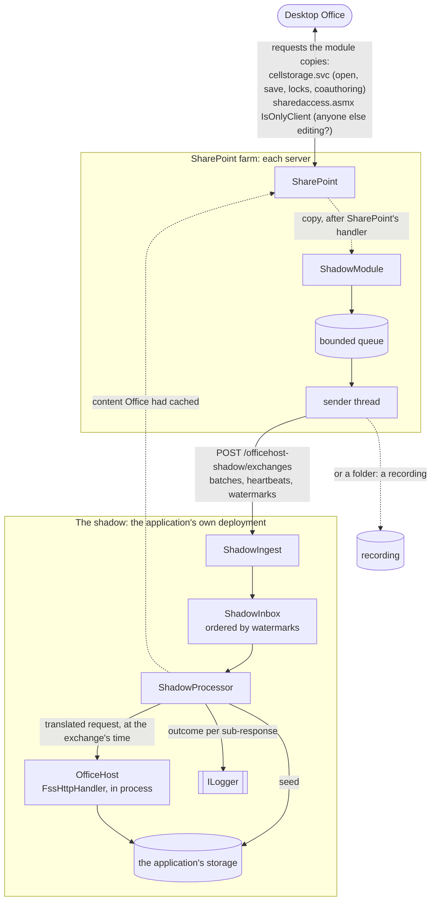
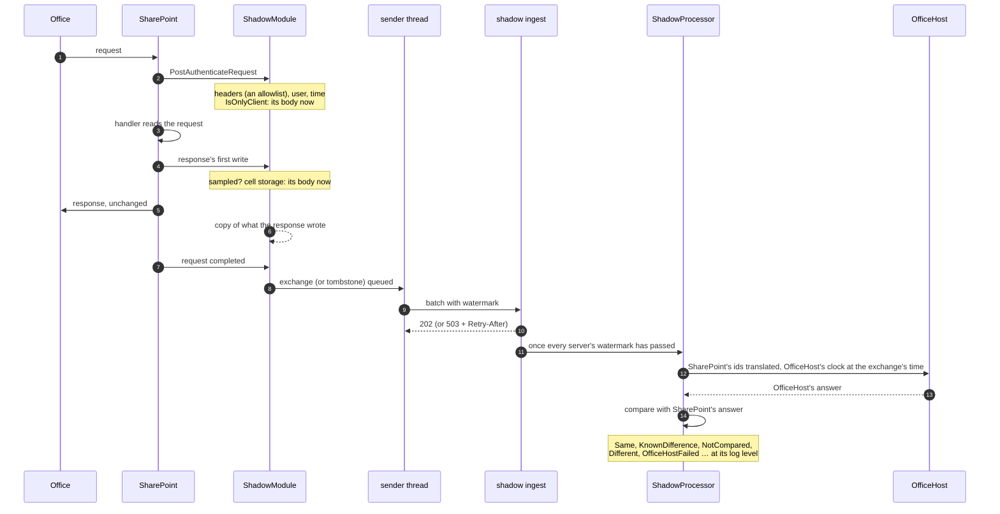
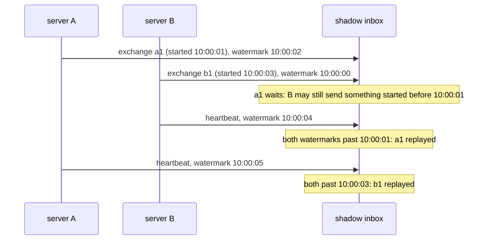

# Shadow: OfficeHost compared with SharePoint on live traffic

A consumer of OfficeHost can run a **shadow** of a SharePoint Server farm: SharePoint goes on serving desktop Office as it
does, and a copy of each exchange goes to a shadow deployment of the consumer's own OfficeHost application, which
replays it, compares OfficeHost's answer with SharePoint's, and logs what it finds. For diagnostics and learning: to
gain confidence in OfficeHost, in the application's use of it, and in its choice of storage, before moving users.

It is made of two packages:
- **OfficeHost.SharePoint**: a module for SharePoint Server 2016, 2019 and Subscription Edition (.NET Framework 4.6.2),
  deployed as a farm solution by the script that comes with it. Tested on Subscription Edition (the lab).
- **OfficeHost.Shadow**: what the application adds to become a shadow: an endpoint the module posts to, and the replay
  and comparison of [replay.md](replay.md), live.


## How it works



What happens to one exchange, from Office to the log:



The shadow replays to OfficeHost in process (the handler of `MapFssHttp`), not over HTTP: no network between them,
and none of the application's middleware. OfficeHost's clock is the time SharePoint received each exchange, so
coauthoring sessions and locks expire as they did on SharePoint, however late the shadow replays.


## The guarantees to SharePoint

SharePoint must never fail, and must not slow down noticeably, because of the module. Each guarantee, and how it is kept:

- **Its answers are unchanged.** The module copies what the response writes after it went to SharePoint's stream, and
  reads the body of a cell storage request only once SharePoint's handler has read it. Reading it before (at
  authentication) made PowerPoint drop the connection of its first request in the lab; reading it after did not
  (docs/replay.md). IsOnlyClient is the exception: after its ASMX handler, its body reads empty, so the module reads it
  at authentication, through the buffered input stream the handler reads too. It is a few hundred bytes, and the lab's
  27 IsOnlyClient requests read so were all answered 200, as without the module.
- **It never fails a request.** Only the module's own work is in a `try`: a failure of SharePoint's stream is
  SharePoint's, a failure of the copy only stops the copy (a tombstone) and goes to the event log, rate limited.
- **Its memory is bounded.** Copies are made in 64 KB chunks (under the large object heap) taken from a budget for all
  requests (`MaxInFlightMegabytes`), and an exchange stops at `MaxExchangeMegabytes`: beyond either, it becomes a
  tombstone. The queue is bounded too, and so are the tombstones (beyond, only counted). A document that is not
  sampled is not copied at all: sampling is decided at the response's first write.
- **It never waits for the shadow.** A thread of its own sends: never a request's. It sends with timeouts; when the
  shadow is full it waits as the shadow asks (503 and Retry-After), copying nothing meanwhile; after three failures it
  stops copying, turns what waits into tombstones, and tries again at each heartbeat, with backoff, until the shadow
  answers.

  ```mermaid
  stateDiagram-v2
      [*] --> Sending
      Sending --> Sending: batch sent (202)
      Sending --> Failing: send failed
      Failing --> Sending: sent
      Failing --> Open: third failure in a row:<br/>what waits becomes tombstones
      Sending --> Waiting: 503 + Retry-After
      Waiting --> Sending: after Retry-After
      Open --> Open: heartbeat failed (backoff, up to 60 s)
      Open --> Sending: the shadow answers
      note right of Open: copies nothing new
      note right of Waiting: copies nothing new
  ```
- **Recycles go as before.** When an app domain stops, the module sends what waits within 5 seconds, from a thread of
  its own, and lets the recycle go on.
- **Nothing else changes in the process.** No package dependencies (the one DLL in the GAC), and nothing of
  `ServicePointManager`, which would change SharePoint's own calls.
- **The install cannot break the farm.** The script deploys the DLL to the GAC of every server, waits until it is
  deployed everywhere, and only then names the module in web.config: a web.config naming it before the DLL is in a
  server's GAC would fail every request of that server. `-Remove` goes in the reverse order. Deploying to the GAC
  recycles the application pools: install in a maintenance window.

  ```mermaid
  flowchart TD
      wsp[build the WSP] --> add[Add-SPSolution] --> deploy[Install-SPSolution -GACDeployment]
      deploy --> wait{deployed on<br/>every server?}
      wait -->|not yet| wait
      wait -->|yes| config[web.config: module and appSettings<br/>SPWebConfigModification]
      config --> check[check web.config and IIS]
  ```
- **It can be paused without a recycle.** A change of web.config recycles every application pool of the web
  application: the shadow can pause the module instead (503), or change its sampling (`SamplePercent` of the shadow's
  options, sent to the module with every answer).


## Install

### The shadow: the application

A separate deployment of the application, with **storage of its own** (SharePoint's documents are written to it),
reachable over HTTPS from the SharePoint servers, as **a single instance** (the shadow keeps its state in memory).

```cs
// the documents of SharePoint in the application's storage: IOfficeStorage has no way to create a file at a path
services.AddSingleton<IShadowDocuments>(new FileSystemShadowDocuments(storage));
// the documents Office opened from its cache, from SharePoint, as an account that can read them
services.AddHttpClient<IShadowContent, SharePointShadowContent>()
    .ConfigurePrimaryHttpMessageHandler(() => new HttpClientHandler { UseDefaultCredentials = true });
services.AddOfficeHostShadow();
...
app.MapOfficeHostShadow();
```

`AddOfficeHost` is needed too, configured as the application's production deployment would be: the point is to test
it. The sample turns into a shadow when `OfficeHostShadow:ApiKey` is set (the `Shadow` snippet of the readme).

`IShadowDocuments` finds or adds the file of a document. For `FileSystemStorage`, `FileSystemShadowDocuments` keeps each
document at its host and path under the root. For SQL Server or Azure Blob Storage, their `Add(folder, name, ownerId,
content)` and a map of document keys to file ids, kept in the application's own database:

```cs
class SqlServerShadowDocuments(SqlServerStorage storage, IShadowDocumentMap map) : IShadowDocuments
{
    public Task<string?> Find(ShadowDocument document, Cancel cancel) => map.Get(document.Key, cancel);

    public async Task<string> Add(ShadowDocument document, Stream content, Cancel cancel)
    {
        var file = await storage.Add($"{document.Url.Host}/{document.Folder}", document.Name, "shadow", content, cancel);
        await map.Set(document.Key, file!.Id, cancel);
        return file.Id;
    }
}
```

A document made by a Save As in SharePoint is made by OfficeHost too, next to the file it was saved from, so `Find`
must find a file by the folder and name of its document (`FileSystemShadowDocuments` does).

### The module: SharePoint

The package `OfficeHost.SharePoint` has the module and its script under `tools/`. On one server of the farm, as a farm
administrator, in an elevated SharePoint Management Shell:

```bash
.\Install-OfficeHostShadow.ps1 -WebApplication https://sharepoint.contoso.com -Sink https://shadow.contoso.com/officehost-shadow/exchanges -ApiKey <key> -SamplePercent 10
```

Then, on each other server, the event log source the module writes to:

```bash
New-EventLog -LogName Application -Source OfficeHost.Shadow
```

`-Sink` can be a folder of each server instead: the module records there, in the format of the replay
([replay.md](replay.md)), for a single server. `.\Install-OfficeHostShadow.ps1 -Remove` takes it out of every web
application, then retracts the solution. The lab installs it with `src/sharepoint-lab/Install-ReplayRecorder.ps1`.


## Configuration

### The shadow (`OfficeHostShadow` section, or `AddOfficeHostShadow(options => …)`)

| Option | Default | |
|---|---|---|
| `ApiKey` | (required) | The key the module sends; anything else is refused (401). |
| `Users` | the login as id | The user of OfficeHost of a login of SharePoint (`i:0#.w\|contoso\alice`). |
| `Levels` | below | The log level of each outcome. |
| `KnownDifferences` | `ShadowRule.Defaults` | The differences that are expected. |
| `SamplePercent` | null | The percentage of documents the module sends, given to it with each answer. |
| `QueueCapacity` | 10,000 | Exchanges waiting; beyond, 503. |
| `MaxBatchMegabytes` | 256 | The largest batch read. |
| `MaximumDelay` | 15 s | How long an exchange waits for a lagging server's watermark. |
| `InstanceTimeout` | 2 min | How long a server counts as active without a batch or heartbeat. |
| `IdleTimeout` | 1 h | How long a document is kept without exchanges: longer than Office keeps a lock unrefreshed. |
| `MaximumDocuments` | 1,000 | Documents kept (two copies of each file); beyond, the least recently seen are forgotten. |
| `SummaryInterval` | 15 min | How often the counts of the outcomes are logged. |
| `RecordingFolder` | null | Writes the exchanges received as recordings, a folder a day, to replay with `ReplayTests.Recording`. |

```json
{
  "OfficeHostShadow": {
    "ApiKey": "...",
    "SamplePercent": 10,
    "Levels": { "Different": "Warning", "OfficeHostFailed": "Error", "NotCompared": "Debug" },
    "KnownDifferences": [
      { "Label": "^GetVersions$", "Facet": "^ErrorCode$", "Reason": "no versions", "SharePoint": "^Success$", "OfficeHost": "^RequestNotSupported$" }
    ]
  }
}
```

### The module (appSettings, set by the script)

| Key | Default | |
|---|---|---|
| `OfficeHostShadow.Enabled` | false | Whether it copies anything. |
| `OfficeHostShadow.Sink` | | The ingest of the shadow, or a folder. |
| `OfficeHostShadow.ApiKey` | | The shadow's key. In web.config, so visible to the farm's administrators; it only lets one post to the ingest. |
| `OfficeHostShadow.SamplePercent` | 100 | Documents copied, by a hash of their URL, the same on every server: all of a document's exchanges or none. |
| `OfficeHostShadow.MaxInFlightMegabytes` | 256 | Copies held at once, across requests. |
| `OfficeHostShadow.MaxExchangeMegabytes` | 64 | The largest exchange copied. |
| `OfficeHostShadow.Include` | (all) | Path prefixes copied, comma separated (`/sites/finance`). |


## Outcomes and log levels

Each sub-response is one outcome, logged by `ShadowProcessor` with the event id of its value and its configured level:

| Outcome | Event id | Default level | |
|---|---|---|---|
| `Same` | 1 | Trace | OfficeHost answered as SharePoint did. |
| `KnownDifference` | 2 | Debug | Only differences the rules expect. |
| `NotCompared` | 3 | Debug | What the answer depends on is not known (Office's cache, a missing exchange). |
| `Different` | 4 | Warning | **The responses are different**: OfficeHost answered otherwise than SharePoint. |
| `OfficeHostFailed` | 5 | Error | **OfficeHost failed**: a server error, an exception, or a sub-request failed that SharePoint did. |
| `ShadowFailed` | 6 | Warning | The shadow's own trouble, as a document's content it could not get. |
| `TapDropped` | 7 | Information | The module dropped exchanges, sent tombstones, or a server stopped sending. |

```
Warning ShadowProcessor: Different: Coauth GetCoauthoringStatus of sharepoint/shared documents/budget.xlsx by i:0#.w|contoso\alice, exchange 4512 of SP01 at 2026-10-28T06:04:59.4630000+00:00: @CoauthStatus: Alone / Coauthoring
Error ShadowProcessor: OfficeHostFailed: Cell PutChanges (translated) of … : ErrorCode: Success / CellRequestFail (OfficeHost answered CellRequestFail where SharePoint succeeded)
```

Every `SummaryInterval`, a summary at Information (event id 100): the counts per outcome and sub-request, the documents
known, the exchanges waiting, received and refused.

A rule (`ShadowRule`) matches a sub-request label (`Coauth JoinCoauthoring`, `Cell QueryChanges (translated)`), a facet
(`ErrorCode`, `@CoauthStatus`, `DocProps`, `content`, `editors`, `FSSHTTPB`) and optionally each server's value, by
regular expressions. The defaults are the differences the lab found expected: GetVersions, which OfficeHost does not
support; the `vti_` properties of GetDocMetaInfo, of which OfficeHost sends a subset; the revision SharePoint adds after
a save (`HaveOnlyDemotionChanges`). What is compared of a sub-response is in [replay.md](replay.md).


## Documents

- **Started on first sight.** The first time the shadow sees a document, it writes its content to the storage (through
  `IShadowDocuments`) and clears what OfficeHost knew of it: from a content query of the exchange that SharePoint
  answered in full, the exact version; else from `IShadowContent`, its version checked against the exchange's Etag. A
  document a Save As makes is left for OfficeHost to make.
- **Trusted, or not.** A document is untrusted:
  - for its content (its Cells are NotCompared) after a save of a client that knew it from Office's cache (OfficeHost
    has not the file SharePoint has), or when SharePoint's version is not the traffic's;
  - for all its state after a tombstone of it, an exchange that came after a later one, a server that stopped sending
    or dropped exchanges, or when first seen within a session (its locks are not known).
  A server error or exception of OfficeHost is OfficeHostFailed all the same.

  ```mermaid
  stateDiagram-v2
      [*] --> Seeded: first exchange of the document
      Seeded --> Trusted: content from a full content query,<br/>or from SharePoint at the Etag's version
      Seeded --> Untrusted: first seen within a session
      Trusted --> ContentUntrusted: save from Office's cache,<br/>or SharePoint's version not the traffic's
      Trusted --> Untrusted: tombstone, late exchange,<br/>server lost or dropped
      ContentUntrusted --> Untrusted: tombstone, late exchange,<br/>server lost or dropped
      Trusted --> [*]: forgotten (idle, or too many)
      ContentUntrusted --> [*]: forgotten
      Untrusted --> [*]: forgotten
      note right of ContentUntrusted: its Cells are NotCompared
      note right of Untrusted: all but OfficeHost's errors NotCompared
  ```
- **Forgotten** after `IdleTimeout` without exchanges, or beyond `MaximumDocuments`: its next session starts afresh,
  from its content.
- **Office's cache.** A client that opened the document from Office's cache saves changes to chunks the shadow never
  saw: its save cannot be made again for OfficeHost. The locks, coauthoring and metadata are compared all the same. In
  practice, the saves are compared for documents a client opened without its cache in the shadow's time: new
  documents, first opens on a machine.


## Order

SharePoint's servers each send their own exchanges, with a **watermark**: the earliest start of what the server has in
flight or waiting, so no exchange that started before it is still to come from that server. The shadow replays an
exchange once every active server's watermark has passed its start, so the exchanges of a document are replayed in
the order SharePoint started them, whichever server took them. A server that lags holds the others back at most
`MaximumDelay`; an exchange later than that makes its document untrusted. The module's clock never goes back within an
app domain (a stopwatch anchored to UTC); the servers' clocks should be in step (NTP), as for Kerberos.




## Protocol

A batch is `POST {pattern}/exchanges`:
- **Headers:** `X-OfficeHost-Shadow-Key`; `X-Shadow-Instance` (a GUID per app domain); `X-Shadow-Server`;
  `X-Shadow-Watermark` (ISO 8601 UTC); `X-Shadow-Dropped` (exchanges dropped without a tombstone since the last batch);
  `X-Shadow-Final: true` on the last batch of an app domain.
- **Body:** none for a heartbeat (every 5 seconds when nothing waits); else `multipart/mixed`, `Content-Encoding:
  gzip`, a part per item, with `X-Shadow-Sequence`, `X-Shadow-Started`, `X-Shadow-Kind`:
  - `exchange`: the request then the response, raw HTTP as a recording has them (with `X-Replay-User` and
    `X-Replay-Time`), the request `X-Shadow-Request-Length` bytes;
  - `tombstone`: `X-Shadow-Document` and `X-Shadow-Reason`, no body.
- **Answer:** 202, or 503 with `Retry-After` (full or paused); `X-Shadow-Sample` when the shadow sets the sampling; 401
  for a wrong key; 400 for a batch it cannot read.

The request headers copied are an allowlist (content type, SOAPAction, user agent, Office's scenario headers): never
credentials, cookies or the request digest. IsOnlyClient is always copied (it names no document, and is small).


## Limits

- **Office's cache**: saves are compared for documents opened without it in the shadow's time (above).
- **One instance of the shadow**: its state is in memory. Several servers of SharePoint are fine.
- **Sampling** is by document: a document is all copied or not at all, the same on every server.
- **Uploads, Office for the web, version restores** change documents outside the traffic: their next session starts
  from SharePoint's content once the document is forgotten, and meanwhile differences of content may show.
- **The folder sink** is for one server: two app domains writing a folder would number alike.


## Security

- Copies of documents and the logins of their users leave SharePoint: send them over **HTTPS** only, keep the shadow's
  storage (and its `RecordingFolder`) private, and delete it when done. `Include` and `SamplePercent` limit what leaves.
- The key is in web.config, visible to the farm's administrators: it only lets one post to the ingest of the shadow,
  and the shadow logs what it receives. Rotate it with the script.
- `SharePointShadowContent` reads documents as the account the shadow runs as (or the credentials of its handler):
  give it read access only.


## Tested

- `ShadowTests`: an OfficeHost recorded as SharePoint would be, posted to a shadow application: all the same, the save
  made again; Different at Warning, and a rule making it a KnownDifference; a failing storage, OfficeHostFailed at
  Error; a tombstone, its document no longer compared; two servers out of order, replayed in order by watermark;
  coauthoring expiring at the recorded times; a wrong key (401); a full inbox (503 and Retry-After); the sampling sent.
- `TapTests`: the module's sampling, bounded copies and queue, watermark, sender (open after failures, 503 kept), the
  folder sink as the replay reads it, and its batches, gzip with a tombstone, read and replayed by a shadow.
- The module itself (System.Web, the install script): in the lab only, as it needs SharePoint; see
  [sharepoint-lab.md](sharepoint-lab.md).

On 2026-10-28, in the lab (SharePoint Server SE 16.0.14326), with the module installed by `Install-ReplayRecorder.ps1`
(the WSP to the GAC, then web.config) sending to the sample, a shadow on the host:
- **Office on new documents:** Word saved a document twice, closed it, opened it again and saved; PowerPoint saved a
  presentation. Of the 61 findings of their 25 exchanges, 51 were the same: the four saves translated, the locks,
  coauthoring, the editors table, `WhoAmI`, `ServerTime` and 10 IsOnlyClient. The other 10 were known: GetDocMetaInfo,
  GetVersions, and `HaveOnlyDemotionChanges` when Word opened the document again. None different, none failed.
  PowerPoint's first request was a GetDocMetaInfo, so the shadow seeded its presentation from SharePoint
  (`SharePointShadowContent`).
- **The shadow stopped:** SharePoint answered as with it. IsOnlyClient took 12 to 87 ms, Word opened the document in
  442 ms and saved it in 146 and 123 ms. The module kept the 15 exchanges of those 37 seconds until its sends failed
  three times (each slowly, probably the connect timing out: the host's closed port does not refuse the VM), then made
  them tombstones, and sent them when the shadow was back. It copied again from the next request.
- **SharePoint's IIS log** (`Find-CellStorageErrors.ps1`): no cell storage request answered other than 200 or 401
  since the module was installed. The day's only others are the two 302s of PowerPoint with the lab's earlier recorder
  (docs/replay.md).
- **Found there:** after its ASMX handler, the body of IsOnlyClient reads empty, even at the response's first write;
  the module reads it at authentication (see "The guarantees to SharePoint").
- **Not yet tested:** the time the module adds to a large save, and `-Remove` leaving web.config and the GAC clean.
