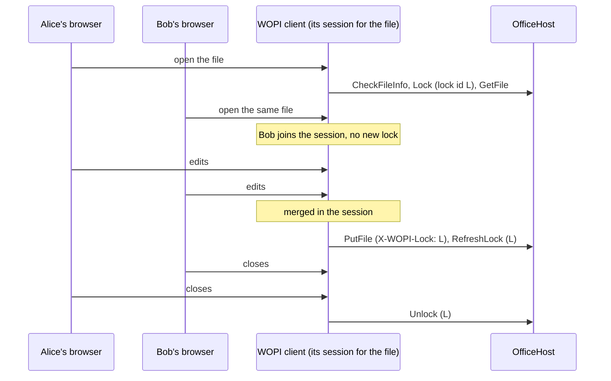

# Several editors over WOPI

How several users editing one file works over [MS-WOPI], and what OfficeHost does about it. For desktop Office, which coauthors through the host, see [fsshttp-concurrency.md](fsshttp-concurrency.md) and rows 17 to 19 of [fsshttp-checklist.md](fsshttp-checklist.md).

## The WOPI client coauthors, the host does not

With WOPI, coauthoring happens inside the WOPI client. Office for the web, Collabora Online and Morph each keep one session per file on their own servers. Every browser editing the file connects to that session, which merges their edits and shows each user where the others are. Only the session talks to the host:

- it takes the lock once (`Lock`), with a lock id of its own;
- it keeps the lock alive with `RefreshLock`;
- it saves the merged document with `PutFile`, under that lock id;
- it releases the lock with `Unlock` when the last editor leaves.

So the host sees the same calls for one editor as for ten. There is no merge, version check or conflict between users on the host side: the users of a session share its lock, and the host does not know how many there are.

## What the host does: the lock

The lock is the only protection the host gives. It decides which client may write; it does not decide between users of one client.

| Request | Accepted when | Otherwise |
| --- | --- | --- |
| `Lock` | the file is unlocked, or locked with the same id (which refreshes the lock) | 409 |
| `Lock` with `X-WOPI-OldLock` (UnlockAndRelock) | the file is locked with the old id | 409 |
| `RefreshLock`, `Unlock` | the file is locked with `X-WOPI-Lock` | 409 |
| `PutFile` | the file is locked with `X-WOPI-Lock`, or it is unlocked and empty (a new file's first save) | 409 |
| `RenameFile` | the file is locked with `X-WOPI-Lock`, or unlocked | 409 |
| `DeleteFile` | the file is unlocked | 409 |

A 409 carries the current lock in `X-WOPI-Lock` (empty for none) and the reason in `X-WOPI-LockFailureReason`, as [MS-WOPI] 3.3.5.1 asks. Every client tells the user something different with it: Office for the web and Collabora open the file read-only, or say that it is locked.

- **The lock is a compare and exchange.** Each lock operation is one `CompareExchange` of the `IOfficeLockStore`, so two clients locking at the same moment cannot both win, even across servers sharing a store (`SqlServerLockStore`).
- **The lock expires.** A lock not refreshed within `LockDuration` (30 minutes, as [MS-WOPI] sets it) counts as no lock: another client can take it, and the old lock can no longer be refreshed or swapped (`EdgeCaseTests.Lock_ExpiredCannotBeRefreshedOrSwapped`). A session that stops refreshing, because its server went down, gives the file up after half an hour at most.
- **The lock is not tied to a user.** One lock covers all the users of a session, so a request with the right lock id is accepted whoever its token is for. Locking, refreshing, unlocking and deleting need a token with write access.
- **Operations on an unlocked file lock it while they run.** `DeleteFile` and `RenameFile` take a short lock of their own, so that no client locks the file in the middle of them.

## Conflicts the host does see

Since users of one session do not conflict on the host, a 409 comes from two writers that are not in the same session:

- **Two WOPI clients.** Alice edits in Office for the web, Bob opens the same file in Collabora. Collabora's `Lock` fails with Office for the web's lock: Bob gets it read-only until the lock is released or expires.
- **A WOPI client and desktop Office.** Desktop Office's lock, a coauthoring session or an exclusive lock, is in the same `IOfficeLockStore`. A WOPI client cannot lock, save, rename or relock a file desktop Office has, even with desktop Office's lock id: a `Lock`, `RefreshLock` or `Unlock` with it is a 400, a `PutFile` or `RenameFile` a 409. Desktop Office's join or exclusive lock fails with `FileAlreadyLockedOnServer` while a WOPI client holds the file. The file is never edited by both.
- **A stale session.** A client whose lock expired, and was taken by another, gets a 409 at its next `PutFile` or `RefreshLock`.

## Changes outside the client

A change to the file in the storage, by the application, while a WOPI client has it open, is not checked by WOPI itself: the client's next `PutFile` overwrites it. Two things limit that:

- **Collabora** sends `X-COOL-WOPI-Timestamp`, the `LastModifiedTime` of its `CheckFileInfo`, with `PutFile`. When the file changed since, OfficeHost answers 409 with `COOLStatusCode` 1010, and Collabora asks the user whether to overwrite; it then saves again without the header (`HardeningTests.PutFile_CollaboraTimestamp`).
- **The application** can take the lock itself (`CompareExchange` with no user) before it changes a file, so that no WOPI client writes meanwhile, or change only files that are not locked.

The `Version` of `CheckFileInfo`, and `X-WOPI-ItemVersion` in the answers of `GetFile`, `PutFile` and the lock operations, let a client notice a new version of the file.

## Code and tests

- `src/OfficeHost/Wopi/WopiHandler.cs`: `Lock`, `RefreshLock`, `Unlock`, `GetLock`, `PutFile`, `RenameFile`, `DeleteFile`.
- `src/OfficeHost/Lock/IOfficeLockStore.cs`, `MemoryLockStore.cs`; `SqlServerLockStore` in `OfficeHost.SqlServer`.
- `src/OfficeHost/FssHttp/Service/CoauthSessions.cs`: desktop Office's side of the shared lock.
- Tests: `src/OfficeHost.Tests/Wopi/SpecTests.cs` (`Lock_*`, `RefreshLock_*`, `Unlock_*`, `UnlockAndRelock_*`, `PutFile_*`), `EdgeCaseTests.cs`, `HardeningTests.cs`.

[MS-WOPI]: https://learn.microsoft.com/en-us/openspecs/office_protocols/ms-wopi/
