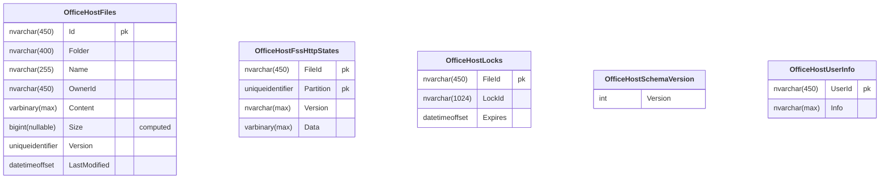

#   OfficeHost

[](https://github.com/Papyrine/OfficeHost/actions/workflows/build.yml)
[](https://www.nuget.org/packages/OfficeHost/)

The host side of the Office document protocols as a library for ASP.NET Core. Add it to a web application, and the files of any storage the application has open, edit and save in:

* the clients of the Web Application Open Platform Interface ([WOPI](https://learn.microsoft.com/en-us/microsoft-365/cloud-storage-partner-program/online/)): Collabora Online, ONLYOFFICE, Microsoft 365 for the web.
* desktop Word, Excel and PowerPoint, through the cell storage service of SharePoint ([MS-FSSHTTP]), with coauthoring in Word and PowerPoint.


## How it works


### In a WOPI client:

1. A user opens a document in the application. The application asks `OfficeLauncher` for the URL of the editor and a WOPI access token, scoped to that file and user.
2. The page of the application posts the token to the editor URL, usually in an iframe.
3. The editor calls the WOPI endpoints the library maps (`/wopi/files/{fileId}`) to read the file metadata, lock the file, and get and save its content. The library checks the token and the locks, and goes to the storage of the application through `IOfficeStorage`.


### In desktop Office:

1. The application asks `OfficeLauncher.LaunchDesktop` for an `ms-word:` (or `ms-excel:`, `ms-powerpoint:`) link to the file, holding an access token in its URL.
2. Office calls the sites the library maps (`/fsshttp/{token}/{name}`) as it calls a SharePoint site: it syncs the file in chunks, takes or shares its lock, and coauthors with the other users. The library keeps the file in `IOfficeStorage`, the lock in `IOfficeLockStore`, and the state of the sync in `IFssHttpStore`.


## Features

* The WOPI file operations: CheckFileInfo, GetFile, PutFile, Lock, GetLock, RefreshLock, Unlock, UnlockAndRelock, PutRelativeFile, RenameFile, DeleteFile, PutUserInfo. Conformance to [MS-WOPI] is tested section by section, and Microsoft's WOPI validator passes.
* Access tokens that grant a user's access to one file: signed tokens out of the box, or any token scheme through `IOfficeTokens`.
* The discovery of the WOPI clients, to launch their actions and validate the proof keys of their requests (`X-WOPI-Proof`).
* Pluggable storage and locks: `FileSystemStorage` and `MemoryLockStore` are included.
* Desktop Office, in preview: Word, Excel and PowerPoint open, edit and save files through the cell storage service of SharePoint ([MS-FSSHTTP]), Word and PowerPoint with the shared lock and coauthoring, Excel with an exclusive lock. See [Desktop Office](#desktop-office).


## Usage

The code below is from [the sample](#sample), which imports the `OfficeHost` namespace. Register a storage and the services, map the WOPI endpoints and the desktop sites, and add the pages that open a file:

<!-- snippet: Registration -->
<a id='snippet-Registration'></a>
```cs
// the storage of the files, here a folder: implement IOfficeStorage for any other
var storage = new FileSystemStorage(folder);
var services = builder.Services;
services.AddSingleton(storage);
services.AddSingleton<IOfficeStorage>(storage);
// the state of desktop coauthoring, kept in a folder so that a restart does not make desktop Office download it all
var states = Path.Combine(builder.Environment.ContentRootPath, "fsshttp-state");
services.AddSingleton<IFssHttpStore>(new FileSystemFssHttpStore(states));
services.AddOfficeHost(
    options =>
    {
        // SigningKey, BaseUrl and DiscoveryUrls come from appsettings.json
        builder.Configuration.GetSection("OfficeHost").Bind(options);
        // the pages below, which the WOPI client links to, as after a Save As
        options.HostEditUrl = (file, _) => $"{appUrl}/edit/{Uri.EscapeDataString(file.Id)}";
        options.HostViewUrl = (file, _) => $"{appUrl}/view/{Uri.EscapeDataString(file.Id)}";
        options.OnCheckFileInfo = context =>
        {
            // back to the file list when the user closes the editor
            context.Properties["CloseUrl"] = appUrl;
            context.Properties["BreadcrumbBrandName"] = "OfficeHost sample";
            context.Properties["BreadcrumbBrandUrl"] = appUrl;
            return Task.CompletedTask;
        };
    });

// a shadow of SharePoint (docs/shadow.md), when the OfficeHostShadow section has an ApiKey:
// the module in SharePoint posts desktop Office's traffic here, and the shadow replays it
// to this application's OfficeHost and logs how the answers compare. A deployment of its own,
// with storage of its own: SharePoint's documents are written to it
var shadow = !string.IsNullOrEmpty(builder.Configuration["OfficeHostShadow:ApiKey"]);
if (shadow)
{
    // the documents of SharePoint as files of the folder, under their host and path
    services.AddSingleton<IShadowDocuments>(new FileSystemShadowDocuments(storage));
    // the documents Office opened from its cache, from SharePoint, as the application's account
    services.AddHttpClient<IShadowContent, SharePointShadowContent>()
        .ConfigurePrimaryHttpMessageHandler(
            () => new HttpClientHandler
            {
                UseDefaultCredentials = true
            });
    services.AddOfficeHostShadow();
}

var app = builder.Build();
if (shadow)
{
    // where the module posts: /officehost-shadow/exchanges
    app.MapOfficeHostShadow();
}

// the WOPI endpoints the WOPI client calls: /wopi/files/{fileId}
app.MapOfficeHost();
// the pages that open a file in the WOPI client: /edit/{fileId} and /view/{fileId}
app.MapOfficePages(Access, OnError);
// the sites desktop Office edits and coauthors files through: /fsshttp/{token}/{name}
app.MapFssHttp();
// the page that opens a file in desktop Office, through an ms-word: (or ms-excel:, ms-powerpoint:) link. The user comes
// from ?user= so that two people can coauthor the demo, and may edit any file: an application takes the user from its
// sign-in, and decides the access from its permissions, as Access below does for the WOPI client
app.MapGet(
    "/desktop/{fileId}",
    async (string fileId, string? user, HttpRequest request, OfficeLauncher launcher) =>
    {
        if (string.IsNullOrEmpty(user))
        {
            user = "demo";
        }

        var access = new OfficeAccess(fileId, user)
        {
            UserName = $"{char.ToUpperInvariant(user[0])}{user[1..]} User",
            CanWrite = true,
            // Save As to a new name in the folder
            CanWriteRelative = true,
            // the rename of Office's title bar
            CanRename = true
        };
        var link = await launcher.LaunchDesktop(access, request);
        return Results.Content(SamplePages.Desktop(link), "text/html");
    });
```
<sup><a href='/src/OfficeHost.Sample/Program.cs#L11-L98' title='Snippet source file'>snippet source</a> | <a href='#snippet-Registration' title='Start of snippet'>anchor</a></sup>
<!-- endSnippet -->

`MapOfficePages` maps the pages that open a file in a WOPI client, `/edit/{fileId}` and `/view/{fileId}`, and `/editnew/{fileId}` for a new document. The application gives it the access of the user to the file, which only it can decide from its own users and permissions, or null to refuse it with a 403, and optionally its own results for the errors:

<!-- snippet: Launch -->
<a id='snippet-Launch'></a>
```cs
// the access of the user to the file: an application decides it from its own users and permissions, or returns null to
// refuse it
static ValueTask<OfficeAccess?> Access(HttpContext context, string fileId, string action)
{
    var canWrite = action is "edit" or "editnew";
    var access = new OfficeAccess(fileId, "demo")
    {
        UserName = "Demo User",
        CanWrite = canWrite,
        CanWriteRelative = canWrite,
        CanRename = canWrite
    };
    return ValueTask.FromResult<OfficeAccess?>(access);
}

// a page of the sample when the WOPI client is down, rather than the default 503 text
static IResult? OnError(HttpContext context, Exception exception)
{
    if (exception is OfficeClientUnreachableException)
    {
        return Results.Content(
            SamplePages.Unreachable(exception.Message),
            "text/html",
            statusCode: StatusCodes.Status503ServiceUnavailable);
    }

    return null;
}
```
<sup><a href='/src/OfficeHost.Sample/Program.cs#L129-L158' title='Snippet source file'>snippet source</a> | <a href='#snippet-Launch' title='Start of snippet'>anchor</a></sup>
<!-- endSnippet -->

The page is `OfficeLaunch.HostPage()`: a form posts the access token to the editor, in a full-page iframe. An application that puts the editor in a page of its own calls `OfficeLauncher.Launch` itself, and takes the form, the iframe and the script from `HostPageHtml()`. A missing file is a 404, a WOPI client that cannot be reached a 503, and an action no WOPI client offers for the file a 400.

The WOPI clients call back the application: they must reach it at the URL of the request that launched the editor, or at `BaseUrl` when it differs, as when the editor runs in a container or behind a reverse proxy.

A new document is an empty file the application creates in its storage, then opens: with the `editnew` action of the WOPI client (Office for the web and Collabora Online offer it), or in desktop Office. The first save writes it, and a WOPI client's first PutFile needs no lock, as the file is empty:

<!-- snippet: NewDocument -->
<a id='snippet-NewDocument'></a>
```cs
// a new document: an empty file, which the WOPI client (its editnew action) or desktop Office fills on the first save
app.MapPost(
    "/new",
    async (HttpRequest request) =>
    {
        var form = await request.ReadFormAsync();
        var name = SampleFiles.NewName(folder, form["type"].ToString());
        await File.WriteAllBytesAsync(Path.Combine(folder, name), []);
        var fileId = Uri.EscapeDataString(storage.GetFileId(name));
        var page = $"/editnew/{fileId}";
        if (form["open"] == "desktop")
        {
            page = $"/desktop/{fileId}";
        }

        return Results.Redirect(page);
    });
```
<sup><a href='/src/OfficeHost.Sample/Program.cs#L100-L118' title='Snippet source file'>snippet source</a> | <a href='#snippet-NewDocument' title='Start of snippet'>anchor</a></sup>
<!-- endSnippet -->

Desktop Office can also Save As: with `CanWriteRelative`, as for the Save As of the WOPI clients, the file is created next to the one being edited, and edited on through the same link.


## Sample

[src/OfficeHost.Sample](src/OfficeHost.Sample) is this setup as a running application: it lists the files of a folder and opens them in Collabora Online, with a host page that loads the editor in an iframe. To try it, start Collabora Online (CODE) in Docker, allowing it to call back the sample. Home mode turns off its welcome dialog, and caps it at 20 connections and 10 documents, which is plenty for trying the sample:

```pwsh
docker run --rm --publish 9980:9980 --add-host host.docker.internal:host-gateway --env "domain=host\.docker\.internal.*" --env "extra_params=--o:ssl.enable=false --o:ssl.termination=false --o:home_mode.enable=true" collabora/code
```

Then run the sample, and open http://localhost:5000:

```pwsh
dotnet run --project src/OfficeHost.Sample
```

It starts with a `Welcome.docx` in `src/OfficeHost.Sample/files`; add files there to open them too, or make a new Word document, Excel workbook or PowerPoint presentation from the top of the list. Edit opens a file with write access, View read only. Desktop Office needs HTTPS: the `desktop` launch profile (`dotnet run --project src/OfficeHost.Sample --launch-profile desktop`) serves it, and `/desktop/{fileId}` opens a file in Word, Excel or PowerPoint, `?user=` for a second user to coauthor. The URLs and the signing key are in its `appsettings.json`: `OfficeHost:BaseUrl` is how Collabora reaches the sample (`host.docker.internal` from the container), and `Sample:AppUrl` how the browser does.


## Options

| Option | Default | |
|---|---|---|
| `SigningKey` | | Signs the access tokens, at least 32 characters. Not needed with another `IOfficeTokens`. |
| `PreviousSigningKeys` | | Keys that signed tokens before `SigningKey`, still accepted, to rotate the key. |
| `TokenLifetime` | 10 hours | How long an access token is valid. |
| `LockDuration` | 30 minutes | How long a lock lasts unless refreshed, as [MS-WOPI] sets it. |
| `BaseUrl` | the request's | The URL the WOPI clients reach the application at: WOPISrc is `{BaseUrl}/wopi/files/{fileId}`. |
| `DiscoveryUrls` | | The trusted WOPI clients: their actions are launched, and their proof keys checked. |
| `RequireProof` | false | Refuses requests without `X-WOPI-Proof`. Collabora Online does not sign its requests. |
| `MaxFileSize` | 512 MB | The largest file PutFile, PutRelativeFile and desktop Office's saves accept, replacing the server's request size limit; null for none. |
| `ServerVersion` | the library's | The `X-WOPI-ServerVersion` of the responses. |
| `HostEditUrl`, `HostViewUrl` | | The pages of the application that open a file, returned by CheckFileInfo and PutRelativeFile. |
| `OnCheckFileInfo` | | Adds or changes CheckFileInfo properties: `CloseUrl`, breadcrumbs, branding, CSPP+ properties. |
| `OnFileSaved` | | Called after a save, by a WOPI client or desktop Office, with the editors: to keep versions or audit. |
| `UrlPlaceholder` | | The values of the placeholders of the action URLs, as `UI_LLCC` or `BUSINESS_USER`; all are dropped without it. |
| `ShareUrl` | | The URL to share a file by, for GetShareUrl; WOPI clients offer no sharing without it. |
| `DesktopPath` | `/fsshttp` | The path of the sites of desktop Office, `MapFssHttp`. |
| `DesktopBaseUrl` | the request's | The URL desktop Office reaches the application at, which runs where the browser does. |


## Access

`OfficeAccess` is what a token grants: a user's access to a file, which the application decides when it launches the
editor.

* `CanWrite`: lock, save and delete the file. Without it the file opens read only.
* `CanWriteRelative`: Save As, creating files next to this one, or replacing an unlocked one other than this one.
* `CanRename`: rename the file.
* `ViewOnly`: no download, print or copy, as the WOPI client enforces it: without `RequireProof`, the token alone can
  still download the file.
* `IsAnonymous`, `UserName`: how the editor shows the user.

The built-in tokens carry the access, signed with `SigningKey`, so they need no storage, but cannot be revoked before they expire; `PreviousSigningKeys` rotates the key without ending the sessions. They are short (about 70 characters, longer with long ids or user names), as desktop Office holds the token in the URL of the file and refuses a Save As to a URL of more than 255 characters; a custom `IOfficeTokens` should keep its tokens short too. To keep tokens in a database, or tie them to the application's sessions, register an `IOfficeTokens`.


## Storage

The storage is the application's: implement `IOfficeStorage` over a database, blob storage or a document management system. File ids are chosen by the storage, and must not change when a file is saved or renamed, as WOPI clients keep using them. A missing file throws `FileNotFoundException`. The storage, the stores below and `IOfficeTokens` can be registered with any lifetime, as scoped for a storage over a database context.

<!-- snippet: IOfficeStorage -->
<a id='snippet-IOfficeStorage'></a>
```cs
public interface IOfficeStorage
{
    /// <summary>
    /// The file, or null when there is none with this id.
    /// </summary>
    Task<OfficeFile?> GetFile(string fileId, Cancel cancel = default);

    /// <summary>
    /// The file of the given name in the folder of the given file, or null when there is none.
    /// </summary>
    Task<OfficeFile?> GetSibling(string fileId, string name, Cancel cancel = default);

    /// <summary>
    /// Opens the content of the file. The caller disposes the stream.
    /// </summary>
    Task<Stream> OpenRead(string fileId, Cancel cancel = default);

    /// <summary>
    /// Replaces the content of the file, returning its new version.
    /// </summary>
    Task<OfficeFile> Write(string fileId, Stream content, Cancel cancel = default);

    /// <summary>
    /// Creates a file of the given name in the folder of the given file. Returns null when a file of that name exists
    /// and <paramref name="overwrite"/> is false; replaces its content otherwise. The name is a legal file name.
    /// </summary>
    Task<OfficeFile?> CreateSibling(
        string fileId,
        string name,
        Stream content,
        bool overwrite,
        Cancel cancel = default);

    /// <summary>
    /// Renames the file, keeping its id. Returns null when a file of that name exists. The name is a legal file name.
    /// </summary>
    Task<OfficeFile?> Rename(string fileId, string name, Cancel cancel = default);

    Task Delete(string fileId, Cancel cancel = default);
}
```
<sup><a href='/src/OfficeHost/Storage/IOfficeStorage.cs#L8-L49' title='Snippet source file'>snippet source</a> | <a href='#snippet-IOfficeStorage' title='Start of snippet'>anchor</a></sup>
<!-- endSnippet -->

`FileSystemStorage` keeps the files in a folder, for development, tests and single machines. It gives each file an id on first use (`GetFileId("reports/q3.docx")`), kept in a hidden `.wopi` folder so that ids survive renames, and writes through a temporary file so that a save never leaves a partial file.

Locks are kept by an `IOfficeLockStore`. The default `MemoryLockStore` suits a single instance of the application; several instances need a shared store, such as one over Redis or a database, with an atomic compare and exchange.

PutUserInfo, where the editors keep per-user data such as the tips a user has seen, is supported when an `IOfficeUserInfoStore` is registered.

The state of desktop coauthoring (the data elements Office syncs, the coauthoring session) is kept by an `IFssHttpStore`: the default `MemoryFssHttpStore` for a single instance, `FileSystemFssHttpStore` for a single machine, or a shared store with an atomic compare and exchange. The file stays in the storage: a lost state only makes Office download the file again. A WOPI DeleteFile deletes the state of the file too; an application that deletes files itself calls `IFssHttpStore.Delete` after them, or the state stays, unused.

### SQL Server

The [OfficeHost.SqlServer](https://www.nuget.org/packages/OfficeHost.SqlServer/) package keeps everything in SQL Server, shared by all the instances of the application: `SqlServerStorage` (the files, in folders the application names, added with `Add(folder, name, ownerId, content)`, which gives the id), `SqlServerLockStore`, `SqlServerFssHttpStore` and `SqlServerUserInfoStore`. Each can be used alone, or `AddOfficeHostSqlServer` registers them all. The tables are created by [OfficeHost.SqlServer.Install](https://www.nuget.org/packages/OfficeHost.SqlServer.Install/), so the application needs no rights to change the schema; `OfficeHostSqlServerInstaller.GetScript()` gives the script to apply by hand. Both take a schema, `dbo` by default.

<!-- snippet: SqlServer -->
<a id='snippet-SqlServer'></a>
```cs
// once, from a deployment step, with rights to create tables
await OfficeHostSqlServerInstaller.Install(connectionString);

// in the application, before or after AddOfficeHost
builder.Services.AddOfficeHostSqlServer(connectionString);
```
<sup><a href='/src/OfficeHost.SqlServer.Tests/SqlServerTests.cs#L201-L207' title='Snippet source file'>snippet source</a> | <a href='#snippet-SqlServer' title='Start of snippet'>anchor</a></sup>
<!-- endSnippet -->


#### The tables

<!-- include: sqlserver-tables. path: /docs/sqlserver-tables.include.md -->

<!-- endInclude -->

The installer keeps the version of the tables in `OfficeHostSchemaVersion`, and brings older tables up to date: ids, lock ids and versions are in a binary collation, so compared as they are whatever the collation of the database, while folders and names follow it (unique ignoring case with the default one). Content is read in chunks of a statement each, so that a slow download holds no connection nor lock.

The tests of the package run on LocalDB, so on Windows only.

### Azure Blob Storage

The [OfficeHost.AzureBlob](https://www.nuget.org/packages/OfficeHost.AzureBlob/) package keeps the files in a blob container, with no other service: `BlobStorage`, registered by `AddOfficeHostBlobStorage(container)`, over a container that exists. Files are added with `Add(folder, name, ownerId, content)`, which gives the id. A file is the blob `files/{id}`, its folder, name and owner in its metadata, so a rename copies nothing; a small blob per name, created only when missing, keeps names unique in a folder, ignoring case, as folders are compared too. A content that cannot be read twice, as a request body, is kept in a temporary file while it is written. The locks and the state of desktop coauthoring need stores of their own, such as those of OfficeHost.SqlServer on Azure SQL.

The tests of the package run on [Azurite](https://github.com/Azure/Azurite) in Docker, through Testcontainers, or on a storage account when `OFFICEHOST_BLOB_CONNECTION_STRING` is set. The storage tests are shared with OfficeHost.SqlServer (`src/StorageContract`), so both storages behave the same.


## Desktop Office

Preview. Desktop Word, Excel and PowerPoint open files as they open those of a SharePoint site: through the cell storage service of [MS-FSSHTTP], which syncs a file in chunks ([MS-FSSHTTPB], [MS-FSSHTTPD]), shares the lock between the users of a coauthoring session, and keeps an editors table.

* `MapFssHttp()` maps the sites: `{DesktopPath}/{token}/{name}` is the URL of a file, the token of `IOfficeTokens` in its path standing for the file and the user, as Office blocks Basic and forms-based sign-in by default.
* `OfficeLauncher.LaunchDesktop(access, request)` gives the link that opens the file: `ms-word:ofe|u|{url}` (or `ms-excel:`, `ms-powerpoint:`; `ofv` without write access).
* Only the Open XML formats are supported (`.docx`, `.docm`, `.dotx`, `.dotm`, `.xlsx`, `.xlsm`, `.xlsb`, `.xltx`, `.xltm`, `.pptx`, `.pptm`, `.potx`, `.potm`, `.ppsx`, `.ppsm`). `LaunchDesktop` refuses the legacy binary formats (`.doc`, `.dot`, `.xls`, `.xlt`, `.ppt`, `.pot`, `.pps`) and `.rtf` with an `InvalidOperationException`: save them in an Open XML format.
* Office can rename the file (from its title bar) through `IOfficeStorage.Rename` when the access has `CanRename`, as for WOPI. Version history is not supported: Office opens, edits and saves without it.
* The lock of desktop editing is a lock of the `IOfficeLockStore`, so WOPI clients and desktop Office do not edit a file at the same time. A file changed outside desktop Office is synced as a new revision, keeping the unchanged chunks.
* Word and PowerPoint coauthor: several users edit a document at once, sharing its lock. Excel does not: the first user to type in a workbook takes an exclusive lock, and Excel tells the others who has it.

The host must use HTTPS with a certificate Windows trusts. A host in the Internet zone opens in Protected View first, as SharePoint Online does. Tested with Word, Excel and PowerPoint for Microsoft 365 16.0.20326 on Windows, with `.docx`, `.xlsx` and `.pptx` files. Notes on what Office does that the specs do not say are in [docs/fsshttp-notes.md](docs/fsshttp-notes.md), and the check by hand in [docs/fsshttp-checklist.md](docs/fsshttp-checklist.md).


## Shadow of SharePoint

Before moving users from SharePoint Server, an application can run as a shadow of it, for diagnostics: SharePoint goes on serving desktop Office, and a copy of each exchange goes to a separate deployment of the application, which replays it to its OfficeHost, compares the answers, and logs what differs, at levels of its choosing ("OfficeHost failed", "the responses are different", known differences, not compared). SharePoint's answers never change, nor fail, because of it.

* [OfficeHost.SharePoint](https://www.nuget.org/packages/OfficeHost.SharePoint/): the module for SharePoint Server 2016, 2019 and Subscription Edition, deployed to the farm by its `tools/Install-OfficeHostShadow.ps1`.
* [OfficeHost.Shadow](https://www.nuget.org/packages/OfficeHost.Shadow/): what the application adds, as the sample does when `OfficeHostShadow:ApiKey` is set:

<!-- snippet: Shadow -->
<a id='snippet-Shadow'></a>
```cs
// a shadow of SharePoint (docs/shadow.md), when the OfficeHostShadow section has an ApiKey:
// the module in SharePoint posts desktop Office's traffic here, and the shadow replays it
// to this application's OfficeHost and logs how the answers compare. A deployment of its own,
// with storage of its own: SharePoint's documents are written to it
var shadow = !string.IsNullOrEmpty(builder.Configuration["OfficeHostShadow:ApiKey"]);
if (shadow)
{
    // the documents of SharePoint as files of the folder, under their host and path
    services.AddSingleton<IShadowDocuments>(new FileSystemShadowDocuments(storage));
    // the documents Office opened from its cache, from SharePoint, as the application's account
    services.AddHttpClient<IShadowContent, SharePointShadowContent>()
        .ConfigurePrimaryHttpMessageHandler(
            () => new HttpClientHandler
            {
                UseDefaultCredentials = true
            });
    services.AddOfficeHostShadow();
}
```
<sup><a href='/src/OfficeHost.Sample/Program.cs#L38-L57' title='Snippet source file'>snippet source</a> | <a href='#snippet-Shadow' title='Start of snippet'>anchor</a></sup>
<!-- endSnippet -->

How it works, its guarantees to SharePoint, its configuration and limits are in [docs/shadow.md](docs/shadow.md). The same engine replays recordings offline: [docs/replay.md](docs/replay.md).


## Proof keys

WOPI clients that publish a `proof-key` in their discovery sign their requests ([MS-WOPI] 2.2.1). The requests that carry `X-WOPI-Proof` are validated against the keys of `DiscoveryUrls`: the current and the old key, for clients that rotate theirs. The keys are cached for an hour, and refetched on a mismatch when over a minute old, so forged requests do not turn into a discovery request each. When a client is down, its last keys are kept, and its discovery is attempted again once a minute.

Requests without proof are accepted unless `RequireProof` is set. The signed URL is `BaseUrl` (or the request's) and the path and query of the request, so `BaseUrl` must be the URL the clients call.


## Development

```pwsh
dotnet build src
dotnet run --project src/OfficeHost.Tests --no-build
```

The test project is a TUnit executable: run it, rather than `dotnet test`. It holds, for WOPI (`Wopi/`):

* `SpecTests`: conformance to the server side of [MS-WOPI], each test citing its section.
* `EdgeCaseTests`: protocol edge cases ported from [WopiHost](https://github.com/petrsvihlik/WopiHost).
* `ProofKeyTests`: the proof key validation, including key rotation.
* `FailureTests`: storage failures, through a storage that fails on demand.
* `KestrelTests`: the request size limits, on Kestrel.

For desktop Office (`FssHttp/`):

* `FssHttpB*Tests`: the FSSHTTPB codec, against vectors, round trips and fuzzing.
* `FileChunkerTests`, `FileCellTests`: the file in a cell, its chunking and revisions.
* `FssHttpServiceTests`, `FileOperationTests`, `PutChangesTests`, `FssHttpCellsTests`, `FssHttpStoreTests`: the sites, the sub-requests and the stores.
* `CoauthoringSimulationTests`, `ExcelTests`, `PowerPointTests`: simulated Office clients (`WordClient`) opening, editing and coauthoring files.

And for both:

* `StorageTests`: `FileSystemStorage` and `MemoryLockStore`.
* `ReplayTests`, `ShadowTests`, `TapTests` (`Replay/`): the replay of recordings, the shadow, and the module in SharePoint but for System.Web, its sources linked.
* `ApiTests`: the launcher, the tokens, the options and the registration.
* `SampleTests`: the sample application, with a stubbed WOPI client.

`src/OfficeHost.E2ETests` hosts the endpoints on a real port and opens documents in real editors, Collabora and ONLYOFFICE, in Docker, driven with Playwright: Collabora opens, edits and saves a document, and ONLYOFFICE opens one with every request validated against its proof keys. It needs Docker and the Playwright browser, and pulls the editor images on the first run (about 1.5 and 4.3 GB):

```pwsh
dotnet build src/OfficeHost.E2ETests
pwsh src/OfficeHost.E2ETests/bin/Debug/net10.0/playwright.ps1 install chromium
dotnet run --project src/OfficeHost.E2ETests --no-build -- --treenode-filter '/*/*/EditorTests/*'
```

Microsoft's [WOPI validator](https://github.com/microsoft/wopi-validator-core) runs with `pwsh src/wopi-validator.ps1` (`-Configuration Debug` for a Debug build): it builds the validator, then runs `ValidatorTests` of the same project, each test group of the validator on a fresh storage. The ProofKeys group is left out: the validator's command line sends no proofs, so `ProofKeyTests` covers them instead.

Code coverage of the library, with a per-file table:

```pwsh
dotnet run --project src/OfficeHost.Tests -- --coverage --coverage-output-format cobertura --coverage-output coverage.cobertura.xml --coverage-settings $PWD/src/coverage.config --results-directory $PWD/TestResults
pwsh src/coverage-summary.ps1 TestResults/coverage.cobertura.xml
```

`-Filter FssHttp/Binary/` limits the table and the total to the files of a folder, here the FSSHTTPB codec.

CI builds and runs the tests on Linux and Windows, with the coverage in the job summary, and runs the WOPI validator on Linux. The editor tests run nightly and on demand (`e2e.yml`), not on every push.

A Release build packs the library into `nugets/`. Pushing a tag releases it: the tag is the version (`1.2.3` or `v1.2.3`), and the `publish` job of `build.yml` pushes the package to nuget.org through trusted publishing, once the tests and the validator pass.


## Credits and license

The WOPI logic started as a port of the Python [CS3 WOPI server](https://github.com/cs3org/wopiserver), by Giuseppe Lo Presti (CERN) and its contributors. Like it, this library is under the Apache 2.0 license, see [license.txt](license.txt).

[MS-WOPI]: https://learn.microsoft.com/en-us/openspecs/office_protocols/ms-wopi/
[MS-FSSHTTP]: https://learn.microsoft.com/en-us/openspecs/sharepoint_protocols/ms-fsshttp/
[MS-FSSHTTPB]: https://learn.microsoft.com/en-us/openspecs/sharepoint_protocols/ms-fsshttpb/
[MS-FSSHTTPD]: https://learn.microsoft.com/en-us/openspecs/sharepoint_protocols/ms-fsshttpd/


## Icon

https://thenounproject.com/icon/fountain-pen-8154546/
